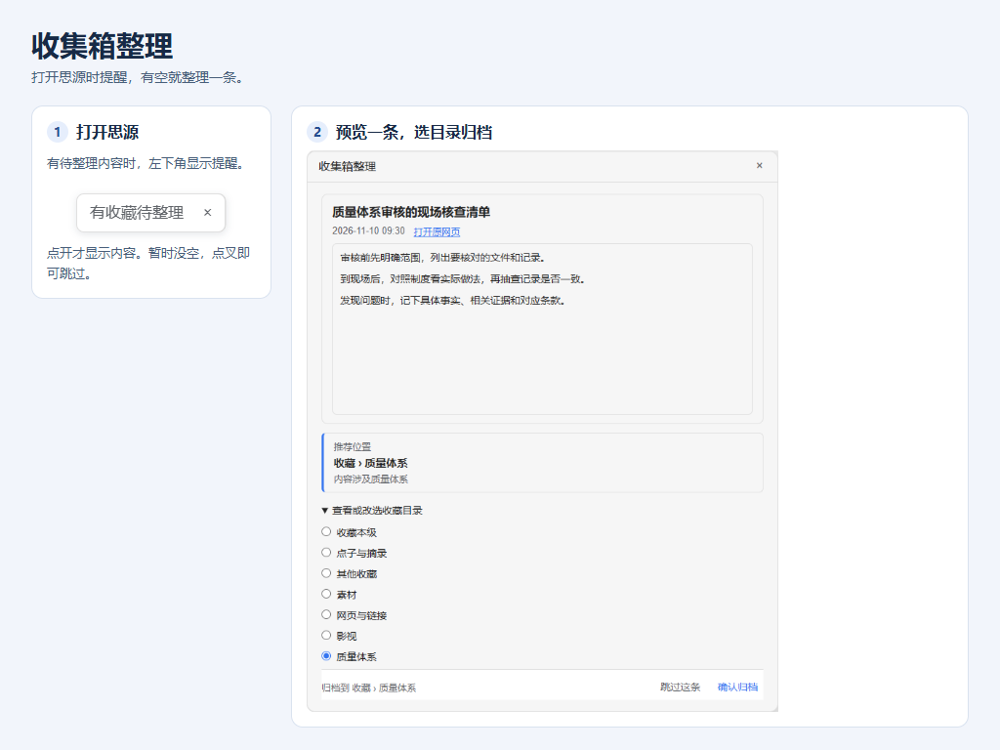

# 收集箱整理

我平时看到想留的网页、点子和图片，会顺手从微信发到思源收集箱。发是经常发，但我很少专门打开收集箱，时间一长就攒了很多条。

所以我做了这个插件。打开思源时，左下角提醒我一下，有空就点开整理一条。提醒上只显示「有收藏待整理」，点开才会看到内容。

适用于思源 3.8.9 及以上的桌面客户端和桌面浏览器。需要能使用思源云端收集箱。正文、图片和附件以收集箱已收录的内容为准。

## 使用

1. 思源启动后，有待整理收藏时，左下角会显示「有收藏待整理」。点击叉号跳过本次。
2. 点开提醒后先看正文、图片或附件。摘要和完整正文在同一个固定高度的预览框里滚动。点缩略图或「查看图片」可在思源里翻看大图。首次使用可以创建「收藏」笔记本和常用目录。
3. 插件给出推荐路径。可在「查看或改选收藏目录」里展开子目录，再点「确认归档」。
4. 每次只处理一条。归档后可结束或继续下一条。

目录直接在思源文档树里维护。在「收藏」下面创建空白子文档作为分类，可以继续新建下一级。已有子文档的分类也会出现在目录树里。

现有笔记本路径可按需展开查看。确认后会复制到「收藏」，原条目可在思源云端收集箱查看。插件用收集箱条目编号识别已归档内容。思源或微信托管的图片和附件可尝试转为本地资源，其他网络资源保留原链接。

## 安装

在思源集市搜索「收集箱整理」，下载后启用。也可以在 [GitHub Releases](https://github.com/370958248/siyuan-inbox-review-local/releases) 下载 `package.zip`，在思源集市从本地包安装。

## 许可证

MIT

